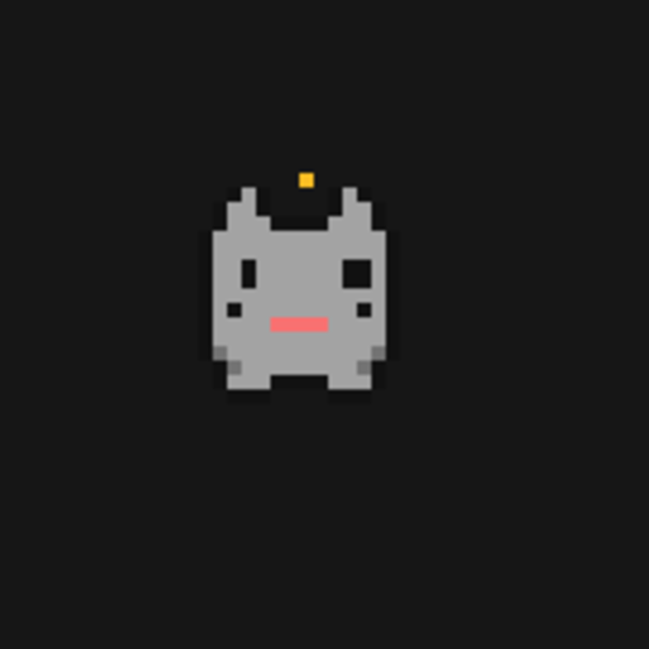

# Oz pet

A small animated pixel companion for [Herdr](https://herdr.dev/). Oz pet reacts to agent activity, can be dragged around the Herdr window, and offers a choice of colors.



## Install

1. Copy `mods/oz-pet` into `~/.config/herdr-app/mods/oz-pet`.
2. Add the following block to the root `floating` array of a **personal or cloned** layout. Do not edit a layout shipped with Herdr directly.

   ```json
   { "id": "oz-pet", "content": { "mod": "oz-pet" }, "edge": "bottom", "align": "end" }
   ```

3. Check the mod with `herdr-app check ~/.config/herdr-app/mods/oz-pet`, then select your layout in Herdr.

The floating block is an invisible launcher for the pet's separate, frameless window. No key bindings are required.

## Settings

The settings panel provides an on/off toggle and five color swatches. To open it, add a control to your own mod or menu that calls:

```js
openOverlay({ mod: "oz-pet", kind: "dialog", props: { panel: true } });
```

This repository does not add a settings button to Herdr's sidebar. See [RECIPE.md](RECIPE.md) for the full behavior, implementation brief, and integration notes.
