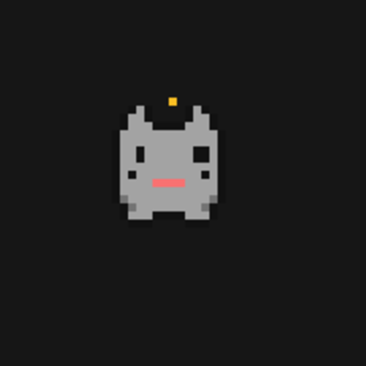

# Oz pet

A tiny pixel companion floats in its own frameless Herdr window. It watches the agents in the app, blinks, works, asks for help or celebrates, and responds to a click with hearts. A separate settings panel switches it on or off and changes its color.



## What you see

- A 16 × 16 pixel-art creature drawn at 4 px per cell (64 × 64 px at zoom 1): pointy ears, a rounded square body, two white eyes and a small nose. Transparent cells leave the background showing. The screenshot is an enlarged crop of the running pet.
- Theme is the default palette: body `muted`, cheeks `accent`, outline and pupils `canvas`, eyes `foreground`, nose and hearts `blocked`, sparks `working`. The other body/cheek pairs are Peach `#e89a65`/`#b96749`, Mint `#83c8b6`/`#4f9b8f`, Blue `#83b4ea`/`#5083c2`, and Rose `#e6a1b2`/`#bd718b`.
- When present, a small rounded, bordered speech bubble sits 3 px above the pet, on `raised`, with 10.5 px text colored `blocked` or `done`.
- The optional Pet settings dialog uses the `surface` background with 18 px padding and 14 px gaps. It has an 18 px semibold title, a Show pet On/Off control, and five 32 px circular color swatches. The selected swatch has a foreground border and a dark center dot; swatches have tooltips and accessibility labels.

## How it behaves

- The most urgent status among all `agents()` wins: blocked > done > working > idle. With no agents, it is idle.
- Idle alternates open and closed eyes every 900 ms. Working alternates its paws every 150 ms, with an effort spark on one frame. Blocked has wide eyes and a flat mouth, alternates its paws every 200 ms, and jitters sideways by 1 px. Done shows happy eyes and sparks, alternates frames every 220 ms, and hops by 2 px.
- On a transition to blocked, the bubble says “needs you!” for up to 8 seconds; on a transition to done it says “done!” for up to 5 seconds. A subsequent status change clears or replaces it.
- Click the pet for 1.4 seconds of alternating hearts at 190 ms per frame. Herdr's frameless window can be dragged; its position is retained by its keyed, kept overlay.
- The settings control toggles the pet; selecting a swatch changes its body and cheek colors. Both settings use persistent shared state. There are no mod-specific key bindings or hover actions on the pet.

## Built from

- Create `mods/oz-pet/mod.json` with `{"place":"none","title":"Oz pet"}` and a `main.js` default-exporting a `View` from `gpui-kit`. Use native `div`, `h_flex`, `v_flex` and `cx.timer`, not a web view. No image files, network access, external programs, or filesystem reads are needed.
- The view has three roles: an empty launcher without `props().overlay` or `props().panel`, a settings dialog with `props().panel === true`, and the pet overlay otherwise. The launcher checks `shared("oz-pet.enabled")` every 500 ms and opens `openOverlay({ mod: "oz-pet", kind: "window", frame: "none", key: "oz-pet", keep: true })` when enabled; it closes its overlay when disabled. The pet also checks enabled in its timer and closes its own `props().overlay` when disabled. The default is enabled.
- To start it, add a floating block to a **personal or cloned** layout, for example inside its root's `floating` array: `{ "id": "oz-pet", "content": { "mod": "oz-pet" }, "edge": "bottom", "align": "end" }`. This package deliberately contains no layout. The launcher renders an empty `div`; the visible pet is the separate window. Do not edit Herdr's shipped layouts directly.
- To expose settings, a launcher mod or custom menu may call `openOverlay({ mod: "oz-pet", kind: "dialog", props: { panel: true } })`. The sidebar entry used in the screenshot's original setup belongs to a separate `oz-chrome` mod and is not included here. Without such a control the pet still works, but this package alone does not add a settings button.
- Read status with `agents()`, colors with `theme()`, and selection with `shared("oz-pet.color")`; write settings using `setShared`. Invalid or absent color falls back to `theme`. Use `closeOverlay` for closing. No `keys.json` is required.
- Draw each row as runs of cells rather than one element per pixel. Start with the following base grid (`.` transparent, `O` outline, `B` body, `C` cheek, `E` eye white, `D` pupil, `N` nose); derive two frames per mood by changing eye, paw and top rows for blinks, steps, wide eyes, sparks and hearts:

```text
....O......O....
...OBO....OBO...
..OBBO....OBBO..
..OBBBOOOOBBBO..
.OBBBBBBBBBBBBO.
.OBBBBBBBBBBBBO.
.OBBEEBBBBEEBBO.
.OBBEDBBBBDEBBO.
.OBBEEBBBBEEBBO.
.OBDBBBBBBBBDBO.
.OBBBBBNNBBBBBO.
.OBBBBBBBBBBBBO.
.OCBBBBBBBBBBCO.
..OCBBBBBBBBCO..
..OBBBOOOOBBBO..
...OOO....OOO...
```

- Tick every 40 ms; redraw only when state, frame, jitter, hop, bubble, or color changes. State overrides art while a pat is active; status changes continue to control the bubble.

## Watch out

- `place: none` does not add a launcher or settings entry on its own; wire the launcher into a personal layout and wire the settings dialog into a separate control. Do not mistake the invisible launcher for the pet itself.
- `keep: true` persists the overlay and location; avoid creating duplicates when a kept window is restored. The included build relies on Herdr's keyed overlay behavior.
- The pet observes all agents in the window, not just the active space. `done` means Herdr's reported done state, not an independently detected completion. Bubble timing starts only on a status transition.
- Art is fixed at 16 × 16 cells; pad or trim override rows to 16. Animation and dragging are handled inside Herdr, not outside its windows. The preview is a crop, not a representation of the whole desktop.

## Done when

1. `herdr-app check mods/oz-pet` passes and `herdr-app status` has no mod errors.
2. After adding the launcher to a personal layout, one draggable pet appears; its location is retained by the kept overlay.
3. Idle, working, blocked and done have the described frames and timing, and a click produces hearts; blocked and done transitions show their respective temporary bubbles.
4. Opening the panel through a separate control shows all five swatches and On/Off. Selecting a color changes the original creature, persists in shared state, and toggling Off hides it; toggling On brings it back.
